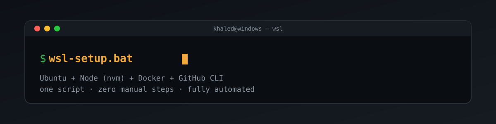
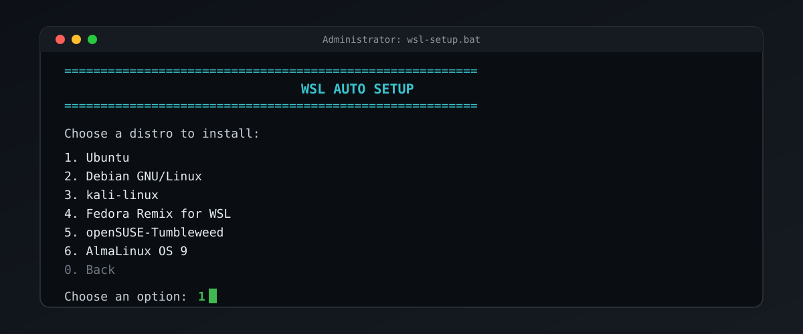

# wsl-setup



Fully automatic WSL setup for a Windows PC. Run one `.bat` file, pick any distro from a live numbered menu, and it does the rest — no interactive WSL setup wizard, no typing anything except a username/password once.



## Usage

1. Clone or download this repo onto your Windows machine. Keep the files together: `wsl-setup.bat` needs `setup-user.sh`, `list-distros.ps1`, `install-distro.ps1` and `wait-distro.ps1` next to it. It checks for all of them at startup and tells you which are missing.
2. Run `wsl-setup.bat` (double-click it, or run from `cmd.exe`). It self-elevates to Administrator via UAC.
3. Pick a distro from the numbered menu — built live from `wsl.exe --list --online`, so it's whatever Microsoft currently offers (Ubuntu, Debian, Fedora, Arch, openSUSE, Kali, AlmaLinux, Oracle Linux, and more), never a hardcoded list that goes stale. The list is read by `list-distros.ps1`, which handles both the UTF-16 output of older wsl.exe builds and the UTF-8 output of newer ones, any intro text, and localized headers. If the list can't be fetched at all (e.g. no network yet), you get a fixed Ubuntu/Debian menu instead, and the reason is shown before the menu appears.
4. Enter a new Linux username and password when prompted. Password input is masked and asked twice, so a typo can't lock you out. Any characters are fine, including `!`, `^`, `%`, quotes and spaces. The username is validated up front against Linux rules — lowercase letters, digits, hyphen and underscore, starting with a letter or underscore, max 32 chars — so an invalid name is rejected immediately (and you're asked again) instead of failing cryptically mid-install.
5. The script installs the distro (`wsl --install -d <name> --no-launch --web-download`, via `install-distro.ps1` with a progress bar), waits for it to become ready (`wait-distro.ps1`), then runs `setup-user.sh` inside it to create the Linux user — `useradd`, `chpasswd`, adds to `sudo` (or `wheel` on Fedora/Arch/openSUSE), installs `sudo` itself first if the image ships without it, and grants **passwordless sudo** (`/etc/sudoers.d/<user>`) so system commands run without a prompt. It also sets the default user in `/etc/wsl.conf` **without clobbering** any existing section (e.g. a `[boot] systemd=true` added by `setup-dev-tools.sh`).
6. It sets that user as the distro's default user, sets the distro as the **machine's** default (`wsl --set-default`), and verifies that typing plain `wsl` in any terminal drops straight into that user with no prompts.
7. It writes/refreshes `start-wsl.bat` next to itself — a one-line launcher (`wsl.exe`) for quick access afterward.
8. The window never closes itself — every path, success or error, ends with a pause so you can read the output.

## What it does differently from the built-in `wsl --install` wizard

- **No plaintext credentials anywhere.** The password is read via PowerShell's masked `Read-Host` and base64-encoded *inside PowerShell*. Only the base64 text comes back to the batch script, so cmd never sees the raw password and can't mangle it (cmd silently drops `!` when delayed expansion is on). It's forwarded into the distro through `WSLENV`, never written to a log, temp file or disk, and never spliced into a shell command line. As soon as the account is created the forwarding is removed and your original `WSLENV` is restored, so later steps (including the dev-tools installer) never see it.
- **Bypasses two documented first-install pitfalls:** uses `--web-download` (Microsoft's own fix for installs hanging at 0.0%) and checks the Windows build number up front (WSL needs build 19041+), instead of failing partway with a confusing error.
- **Re-runs reliably.** Whether a distro is already installed is read from the registry (`HKCU\...\Lxss`), not by parsing `wsl -l -q`, whose UTF-16 output on older wsl.exe builds made the check fail and the re-run try to install it again.
- **Explains the reboot case.** A first-ever WSL install on a machine can require a Windows restart partway through; if that happens, the script says so plainly and tells you to just re-run it afterward.

### Dev tools (Node, Docker, GitHub CLI)

`setup-dev-tools.sh` installs nvm/Node (LTS), Docker Engine, and the GitHub CLI inside a **Debian/Ubuntu-based** WSL distro. On other distros it stops right away with a clear message instead of failing halfway. Two ways to run it:

- **At the end of `wsl-setup.bat`** — after a distro is set up, the script offers to run it for you inside that distro (`[y/n]` prompt). Pick `y` and it runs unattended (the passwordless sudo set up above lets `apt`/Docker install without prompts).
- **Manually, anytime** — from inside a WSL shell:

  ```bash
  bash setup-dev-tools.sh
  ```

It is safe to re-run: Node is skipped if already installed, Docker/gh are skipped if present, and systemd is only enabled once (an existing `systemd=false` is flipped in place, not duplicated). After it adds you to the `docker` group you must open a new shell (or run `newgrp docker`) before `docker` works without `sudo`, and because it enables systemd you'll be told to run `wsl --shutdown` once for Docker to start automatically.

## Testing

The in-distro shell logic is covered by a harness that needs neither Windows nor a real WSL distro:

```bash
bash test/run-tests.sh
```

It runs the real `setup-user.sh` (with `useradd`/`chpasswd`/`usermod` stubbed and `/etc` paths redirected) 100 times per scenario. The scenarios are: fresh machine, preserving an existing `[boot] systemd=true`, idempotent re-run, `[user]` without `default=`, and sudo missing from the image. Every run also checks that `chpasswd` got the exact password, using one full of shell- and cmd-special characters. It then sources `setup-dev-tools.sh` and runs its real `enable_systemd` across seven wsl.conf states. If PowerShell 7 (`pwsh`) is installed, `test/list-distros.tests.ps1` runs the real `list-distros.ps1` against a fake `wsl.exe`. It covers UTF-16 with/without BOM, UTF-8 with/without BOM, CRLF/LF/CR-CR-LF line endings, 0–3 intro lines, a localized header, network errors, a missing wsl.exe and a hang. Also with `pwsh` (it runs on Linux too; point `PWSH=` at it if it isn't on `PATH`), `test/bat-powershell.ps1` also runs. It pulls every PowerShell snippet out of `wsl-setup.bat`, including the scripts the `.bat` writes out with `echo`, and parses each one. It then runs the real username/menu validation against hostile input (`dev&calc`, `dEv`, `1&calc`, …) and the real password step, checking that the returned base64 decodes to exactly the password typed.

`test/install-wait.tests.ps1` runs `install-distro.ps1` and `wait-distro.ps1` against fake `wsl.exe` scripts. It checks the arguments passed, success, failure (with UTF-16 error output), a missing `wsl.exe`, ready-after-retries, timeout and a pending reboot.

### End-to-end (opt-in)

```bash
E2E=1 WINE=wine MINGW_CC=x86_64-w64-mingw32-gcc PWSH=pwsh bash test/run-tests.sh
```

`test/e2e/run-e2e.sh` runs the **real `wsl-setup.bat` under Wine's `cmd.exe`**. `test/e2e/driver.py` types answers one prompt at a time, like a person would. Four scenarios are covered:

- **Live list:** UTF-16 live list → invalid number → injection attempt → menu number → bad username → password mismatch → install → account setup → verification.
- **Re-run:** a re-run on an already-installed distro.
- **Offline:** offline fallback menu.
- **Install another:** a second distro in the same run.

It checks that each menu number installs the right distro, `chpasswd` receives the exact password, `wsl.conf` and sudoers are written, and the credentials are forwarded into *only* the one `wsl.exe` call that needs them.

What's faked: `wsl.exe` (`test/e2e/fake_windows.py`), the registry lookup, the Windows build number and the admin check. `test/e2e/proxy.c` bridges `cmd.exe` to them, because Wine drops the exit code of Linux programs. Wine's `cmd.exe` is a reimplementation with a few gaps, and it can't print the menu entries themselves (see the note in `run-e2e.sh`).

### Continuous integration

Every pull request runs `.github/workflows/test.yml`:

- **Linux:** shellcheck, plus the whole suite above including the Wine end-to-end test.
- **Windows (real `cmd.exe` + Windows PowerShell 5.1):** every `.ps1` is parsed with 5.1. Then `test/e2e/windows/run_e2e_windows.py` runs the real `wsl-setup.bat` in a real console (ConPTY via `pywinpty`) through the same four scenarios. It types into the real masked `Read-Host` prompts, and the real registry lookup, `fltmc` and build check all run. Only `wsl.exe` is faked, by `WslShim.cs` → `fake_windows.py`. This job also checks the menu text itself, which Wine can't print.

What is still not covered anywhere: a real `wsl --install` and a real Linux distro. Those need a machine with WSL itself, which CI runners don't offer.

## Notes

- The created Linux user has **passwordless sudo** — convenient for a personal dev machine, but means any process running as that user can act as root without a password. Don't use this on a shared or security-sensitive machine.
- Re-running the script against a distro that's already installed is safe — user creation is idempotent (`id -u ... || useradd ...`).
